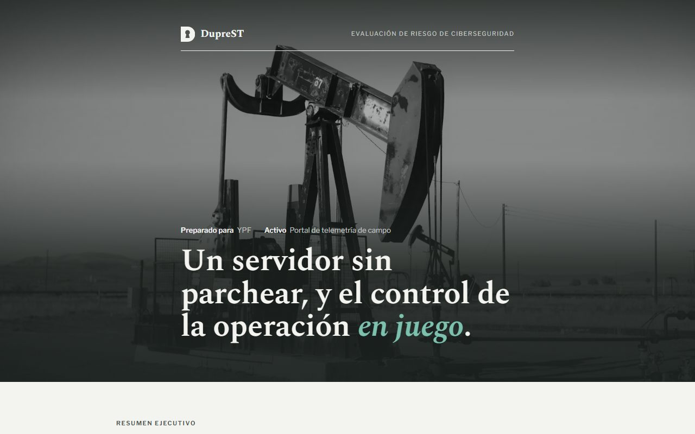

# DupreST · Evaluación de riesgo para YPF

Landing de una sola página: DupreST, una consultora de ciberseguridad ficticia,
le presenta a YPF el riesgo de un servidor sin parchear y lo que cuesta evitarlo.
Es un pitch ejecutivo pensado para un CEO: poco texto, una cifra principal y tres
gráficos (matriz de riesgo, torta de impacto y barras de prevención contra
incidente).

Trabajo práctico final del curso de Ciberseguridad de la Fundación YPF
(Comisión 1 · Grupo 4).

> **Los números son ilustrativos.** Están basados en benchmarks de la industria y
> no representan datos reales de YPF. La página lo dice al pie, y un test verifica
> que el aviso esté a la vista.



## Stack

- Next.js 16 (App Router) con TypeScript estricto y Tailwind CSS 4.
- Contenido estático y tipado en `contenido/informe.ts`: no hay base de datos ni
  backend.
- Gráficos en SVG y CSS hechos a mano y renderizados en el servidor. El HTML trae
  el estado final; la animación es una capa encima.
- Playwright con axe para accesibilidad (WCAG 2.1 AA).

## Cómo se corre

Requiere Node 24.

```bash
npm install
npm run dev
```

Queda andando en http://localhost:3000.

## Verificación

Lo mismo que corre el CI en cada push:

```bash
npm run typecheck && npm run lint && npm run build && npx playwright test
```

Los tests corren contra el build de producción. La primera vez hace falta
`npx playwright install chromium`.

## Estructura

```
app/          la página, el layout, la imagen OG, robots, sitemap y el 404
components/   logo, encabezado de sección, torta, matriz, barras, y la cifra y
              el revelado, que son las dos únicas piezas de cliente
contenido/    todos los textos y números del informe
lib/          la URL canónica y las fuentes de la imagen OG
public/       la foto de tapa, ya optimizada
scripts/      optimize-assets: pasa los originales de assets-raw/ a webp en
              blanco y negro (`npm run assets`)
tests/        accesibilidad y el aviso de datos ilustrativos
```

## Deploy

Está pensado para Vercel: se importa el repo y no hace falta cargar variables.
La URL canónica sale sola de `VERCEL_PROJECT_PRODUCTION_URL`; con un dominio
propio, se define `NEXT_PUBLIC_SITE_URL`.

## Licencias

- Spectral y Libre Franklin se distribuyen bajo la SIL Open Font License. Los
  textos de licencia de las copias que usa la imagen OG están en
  `lib/fuentes-og/`.
- La foto de tapa es de [Jacob Padilla](https://unsplash.com/@jacob17pad) en
  [Unsplash](https://unsplash.com), bajo la licencia de Unsplash.
